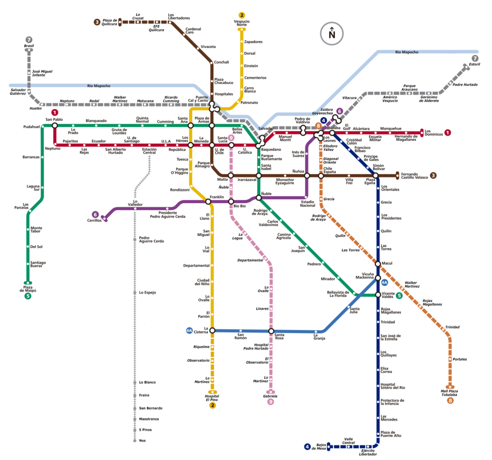

# Introducción {.unnumbered #sec-introduccion}

Una red de transporte puede observar miles de señales cada día: un aviso del personal, una denuncia, una interrupción del servicio, una cámara que detecta una situación anómala o una persona que deja de usar cierto acceso porque se siente insegura. Ninguna señal, por sí sola, indica dónde intervenir primero. **Anticipar** consiste en reunirlas, comprobar qué representan y elegir una acción antes de que un problema se repita o se agrave. **Prevenir** consiste en modificar una condición que contribuye a ese problema.

Esta sesión introductoria parte de una pregunta de gestión: **¿cómo puede el análisis ayudar a elegir una respuesta preventiva pertinente para un lugar y un problema?** En tres horas revisaremos enfoques de prevención, fuentes de información, lectura espacial y familias de modelos. El objetivo es reconocer qué pregunta responde cada herramienta, qué datos necesitaría Metro para usarla y cuáles son sus límites. La clase ofrece criterios para orientar análisis posteriores; **no contempla elaborar una ficha de decisión ni ajustar un modelo durante la sesión**.

## De la red al lugar del problema

La escala del análisis depende de la decisión pendiente. Una tendencia de seguridad para Santiago puede situar el contexto urbano; un registro de la red permite comparar líneas o estaciones; una intervención en un acceso exige observar ese acceso, su franja horaria y la relación con la calle. Cambiar de escala requiere **cambiar también las fuentes, la unidad de análisis y la medida de exposición**. Un dato de ciudad no localiza por sí solo un problema dentro de una estación.

{#fig-red-metro width="78%"}

El esquema deja ver estaciones e intercambios, incluida la **Línea 3**. También dibuja trazados de las líneas 7, 8 y 9; para consultar las líneas y estaciones operativas corresponde usar el [plano publicado por Red Movilidad](https://www.red.cl/mapas-y-horarios/metro/). En seguridad, la imagen recuerda que una prioridad para toda la red puede ocultar situaciones diferentes entre estaciones y, dentro de una estación, entre andenes, pasillos, accesos y su entorno.

::: {.callout-note}
## Ejemplo documentado · Metro de Santiago, marzo de 2025

Una comunicación del Gobierno Regional Metropolitano de Santiago sobre el retorno masivo de marzo informó medidas de seguridad y operación de Metro: refuerzo de personal, cámaras, videoanalítica, apoyo a usuarios en horas punta y coordinación con policías y municipios. También señaló el comercio irregular en accesos como preocupación. La publicación tituló la noticia «Autoridades presentan plan marzo seguro en Metro» y en el cuerpo se refirió al **Plan de Seguridad Operacional** [@gobiernoSantiago2025metro].

**Lectura metodológica de esta guía:** preparar dotación y oferta antes del retorno masivo de marzo es una forma de **anticipación operativa** ante un cambio estacional esperado. El refuerzo de presencia, monitoreo, apoyo y coordinación busca **prevenir o responder** a situaciones de riesgo; algunas medidas podrían actuar mediante mecanismos situacionales que tendrían que comprobarse. Esta clasificación es una inferencia a partir del anuncio, no una evaluación hecha por la fuente. La nota **no presenta un modelo predictivo ni evalúa si disminuyeron los delitos**; tampoco entrega un diagnóstico por estación. Por ello, este libro usa el caso para pensar qué datos harían falta antes de focalizar o evaluar una medida. La publicación figura fechada en 2025, aunque una línea del cuerpo dice «2024»; usamos la fecha del encabezado y del retorno anunciado para el lunes 3 de marzo de 2025.
:::

La distinción orienta el recorrido: una señal puede justificar preparación, pero una medida preventiva requiere precisar **qué problema atender, en qué ámbito y momento, con qué mecanismo y junto a qué actores**. Los casos del libro separan lo documentado de las aplicaciones que requerirían registros operacionales y observación en terreno.

Para leer esta guía, conviene distinguir tres tipos de afirmación: **hechos documentados** en fuentes públicas, **métodos** respaldados por investigación o documentos técnicos, y **ejemplos hipotéticos** que necesitarían datos de Metro para aplicarse. Cada capítulo muestra cómo la pregunta del bloque conduce al siguiente. Las explicaciones técnicas más detalladas quedan como material de consulta para un estudio posterior.

::: {.callout-note}
## Tres ámbitos que mantendremos separados

- **Interior de estación:** andenes, pasillos y zonas bajo operación de Metro.
- **Accesos:** transición entre la estación y la superficie, donde importan los flujos y el límite de responsabilidades.
- **Entorno de caminata:** calles, paraderos, comercio y espacios públicos conectados con la estación.

Un hecho registrado en uno de estos ámbitos no se suma automáticamente a los de otro. Cada ámbito requiere una unidad de análisis, una medida de exposición y actores responsables adecuados.
:::

## Agenda de trabajo

La clase va de **14:30 a 17:45**: 180 minutos lectivos y una pausa de 15 minutos. Los cuatro bloques temáticos reciben 40 minutos cada uno; la introducción y las conclusiones, 10 minutos cada una. Es un recorrido panorámico apoyado en ejemplos, sin actividades de elaboración durante la clase.

| Horario | Tiempo | Momento | Pregunta orientadora |
|---|---:|---|---|
| 14:30–14:40 | 10 min | Introducción y ejemplo documentado | ¿Qué distingue anticipar de prevenir? |
| 14:40–15:20 | 40 min | [1. Enfoques de prevención](06a-enfoques-preventivos.qmd) | ¿Qué condición se busca modificar? |
| 15:20–16:00 | 40 min | [2. Datos de seguridad](06b-datos-territoriales.qmd) | ¿Qué información permite describir el problema? |
| 16:00–16:15 | 15 min | **Pausa** | |
| 16:15–16:55 | 40 min | [3. Análisis espacial](06c-lectura-espacial.qmd) | ¿Dónde y cuándo aparecen patrones? |
| 16:55–17:35 | 40 min | [4. Modelamiento espacial](06d-modelamiento.qmd) | ¿Qué factores podrían relacionarse con esos patrones? |
| 17:35–17:45 | 10 min | [Conclusiones](conclusiones.qmd) | ¿Cómo orientar una decisión y su seguimiento? |

: Horario de la sesión: 180 minutos lectivos entre 14:30 y 17:45, más 15 minutos de pausa. {#tbl-agenda}

```{mermaid}
flowchart LR
  A[Problema y ámbito] --> B[1. Enfoques]
  B --> C[2. Datos]
  C --> D[3. Análisis espacial]
  D --> E[4. Modelamiento]
  E --> F[Decisión y seguimiento]
```

El esquema resume una lógica de análisis, no una tarea para completar en clase. Por ejemplo, «mejorar la seguridad de la red» es un propósito amplio; estudiar si conviene reforzar el apoyo en un acceso durante una franja de alta afluencia plantea una pregunta más precisa. La sesión permite reconocer esa diferencia y las evidencias que harían falta para responderla después.

La primera elección será el mecanismo: qué condición, si cambiara, podría reducir el problema. Esa es la tarea de [Enfoques de prevención](06a-enfoques-preventivos.qmd).
