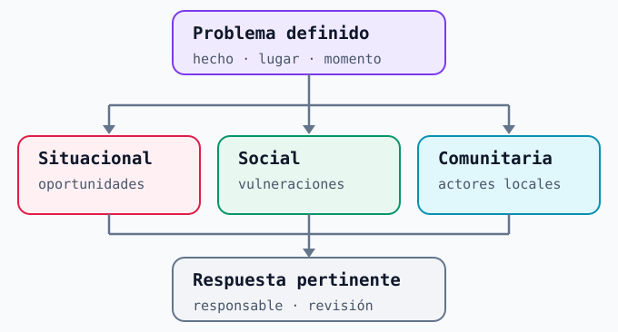
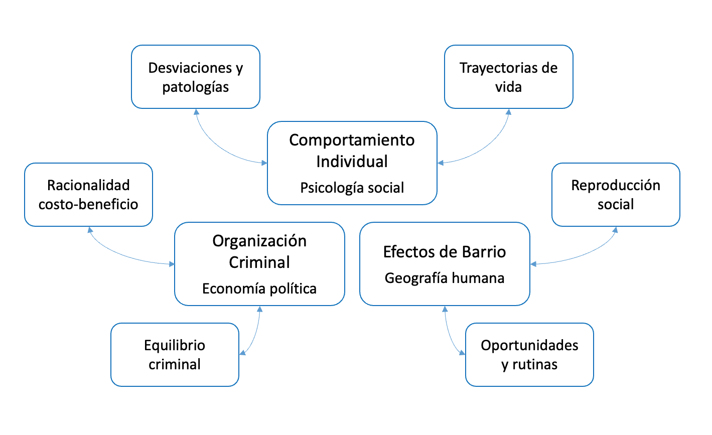
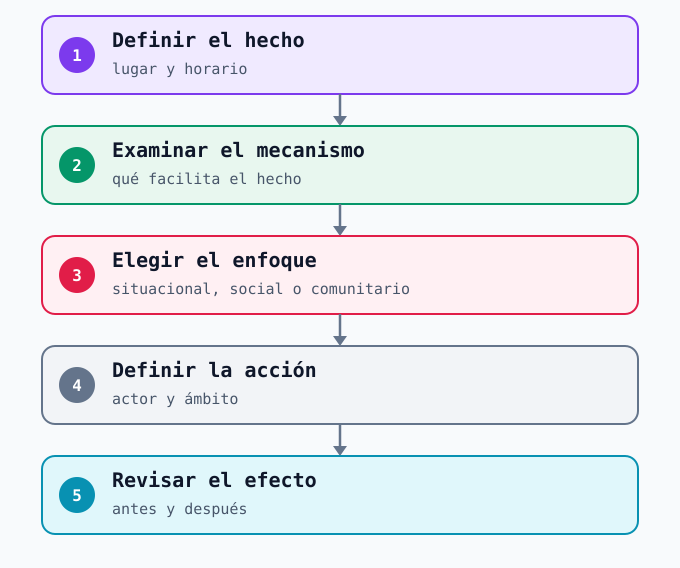

# Enfoques de prevención {#sec-enfoques}

Una estrategia preventiva comienza por una pregunta: **¿qué condición concreta se espera modificar?** Una cámara puede ayudar a detectar y responder; el ordenamiento de un flujo puede cambiar una oportunidad; una alianza local puede sostener una acción fuera del recinto. La medida se vuelve más precisa cuando se declara el mecanismo que la conecta con el problema. Esta pregunta sirve tanto para Metro como para otros lugares de alta afluencia.

Esta distinción sigue el [módulo docente de prevención del delito de UNODC](https://www.unodc.org/e4j/en/crime-prevention-criminal-justice/module-2/key-issues/2a--detailed-explanation-of-tonry-and-farringtons-typology.html), que diferencia intervenciones sociales, comunitarias y situacionales por el proceso que intentan modificar. Aquí el punto de partida es la operación de Metro; los otros enfoques indican cuándo una respuesta necesita redes y tiempos que exceden la estación.

## Tres enfoques, tres preguntas

| Enfoque | Qué intenta cambiar | Pregunta útil para Metro | Horizonte habitual |
|---|---|---|---|
| **Situacional** | Oportunidades y condiciones inmediatas de un hecho en un lugar | ¿Hay un punto, horario o proceso operativo que facilita el problema? | Corto plazo, con ajustes verificables |
| **Social** | Condiciones de vulnerabilidad y trayectorias de daño sostenido | ¿El problema requiere una respuesta especializada que excede la operación de transporte? | Mediano o largo plazo |
| **Comunitario** | Coordinación, confianza y capacidad de acción entre actores locales | ¿Quién conoce y gestiona el entorno de la estación junto a Metro? | Continuo, según el territorio |

: Los enfoques se eligen por el mecanismo que se quiere cambiar, no por el nombre de la tecnología utilizada. {#tbl-enfoques}

{#fig-tres-enfoques width="100%"}

## Prevención situacional

La **prevención situacional** suele ser el punto de partida para una decisión operativa de Metro: examinar visibilidad, circulación, supervisión, señalización o respuesta en un lugar y una franja horaria. Esto requiere un hecho definido. «Hurtos reportados dentro de la estación» y «acoso en un tren» pueden compartir un espacio, pero no necesariamente el mismo mecanismo ni la misma respuesta.

El [marco de Clarke, difundido por el Center for Problem-Oriented Policing](https://popcenter.asu.edu/sites/g/files/litvpz3631/files/about/indexd977.html?p=situational) ordena técnicas situacionales en cinco mecanismos: aumentar el esfuerzo, aumentar el riesgo percibido de detección, reducir recompensas, disminuir provocaciones y facilitar el cumplimiento de reglas. Cada mecanismo requiere un problema y un lugar concretos. Por ejemplo, ordenar una fila puede reducir fricciones en un acceso; hacer visible un canal de ayuda puede facilitar una respuesta segura ante acoso. Esas relaciones deben contrastarse con la observación y los registros del lugar: **instalar una cámara o sumar personal no demuestra por sí mismo una reducción de hechos**.

## Prevención social

La **prevención social** atiende factores de riesgo y protección que se acumulan en trayectorias de personas o grupos y que requieren respuestas sostenidas. Su escala temporal y sus responsables suelen superar la operación de una estación. Metro puede reconocer una necesidad de apoyo, asegurar un trato adecuado y activar una derivación; la intervención especializada corresponde a instituciones con esa función. Tampoco se puede inferir una «causa social» de un incidente individual o de la presencia de personas en un lugar.

Como **ejemplo documentado de articulación institucional en Chile**, el [Reporte de Sostenibilidad 2019 de Metro](https://sostenibilidad.metro.cl/wp-content/uploads/2020/07/reporte_sostenibilidad_metro_2019.pdf) informa que ese año habilitó el número 1488 para recibir denuncias de acoso sexual, en el marco de un convenio con el Ministerio de la Mujer y la Equidad de Género. El canal es un antecedente histórico de atención y registro, no una indicación de contacto vigente ni una intervención social completa. Una prevención social del acoso exigiría trabajo sostenido sobre normas de convivencia y violencia de género con instituciones competentes; su efecto tampoco se deduce de la existencia del canal.

## Prevención comunitaria

La **prevención comunitaria** construye capacidad de acción entre quienes comparten un territorio: instituciones, residentes, usuarios y actores del entorno. En Metro cobra especial importancia cuando el problema cruza el límite entre estación, acceso, calle y ruta de caminata. Una mesa entre organismos puede facilitar la coordinación, pero para hablar de trabajo comunitario también importa cómo se escuchan las experiencias locales y se sostienen los acuerdos.

El [anuncio de seguridad y operación de marzo de 2025](https://www.gobiernosantiago.cl/2025/02/27/autoridades-presentan-plan-marzo-seguro-en-metro/) menciona convenios con municipios y alianzas con comunidades escolares para «senderos seguros» hacia las estaciones. Es un ejemplo de **articulación prevista**, sin información suficiente para evaluar su implementación o su efecto. Como referencia comparada, la [guía británica sobre espacios contiguos a estaciones](https://www.gov.uk/government/publications/land-adjacent-to-railway-bus-and-coach-stations-security-reducing-vulnerabilities/guidance-to-local-authorities-mitigating-security-vulnerabilities-outside-railway-bus-and-coach-stations) propone revisar visibilidad, iluminación y continuidad de vigilancia entre operador y autoridad local. Su valor para esta clase es la pregunta por el **borde del recinto**, no la transferencia automática de una solución a Santiago.

## Teorías que ayudan a formular el mecanismo

Los **enfoques de prevención** indican dónde y con quién intervenir. Las **teorías de criminalidad** ayudan a formular una explicación contrastable de por qué aparece o persiste un problema. La siguiente imagen reúne tres familias de preguntas —conducta individual, organización criminal y efectos de barrio— y conecta cada una con dos perspectivas. Es un **esquema docente**, no una clasificación exhaustiva ni un modelo causal demostrado por sus flechas.

{#fig-teorias-criminalidad width="100%"}

### Conducta individual y psicología social

La rama **«desviaciones y patologías»** recoge un lenguaje histórico que intentó explicar conductas mediante características personales. Conviene leerla críticamente: **desviación no equivale a enfermedad**, y un reporte de seguridad no permite diagnosticar a nadie. La teoría del etiquetamiento de Howard S. Becker [@howardBecker1963] muestra, además, que las reglas y las reacciones sociales influyen en quién recibe la etiqueta de «desviado». La perspectiva del desarrollo de Moffitt [@moffitt1993] distingue trayectorias de conducta que cambian con la edad y con el entorno; tampoco autoriza inferir una trayectoria personal desde un incidente aislado.

La otra rama, **«trayectorias de vida»**, pregunta cómo vínculos, oportunidades y puntos de inflexión pueden alterar una trayectoria a lo largo del tiempo. Laub y Sampson [@laubSampson1993] documentaron que los lazos sociales en la adultez pueden acompañar cambios en la conducta. Esta escala temporal conversa sobre todo con la **prevención social**: frente a una situación de vulneración persistente, Metro puede facilitar ayuda y derivación, mientras las instituciones competentes realizan el trabajo especializado. No corresponde convertir una teoría del desarrollo en perfiles de pasajeros.

### Organización criminal y economía política

La rama de **«racionalidad costo-beneficio»** pregunta cómo una oportunidad concreta, el beneficio esperado y la posibilidad de ser detectado influyen en una decisión. Becker [@garyBecker1968] formuló el enfoque económico; Clarke y Cornish [@clarkeCornish1985] lo llevaron a decisiones específicas de cada tipo de hecho. Esto alimenta la **prevención situacional**: si una sustracción aprovecha un punto ciego o una aglomeración, se examina esa oportunidad y se prueba un ajuste del lugar o de la respuesta.

La expresión **«equilibrio criminal»** del esquema orienta otra pregunta: ¿qué condiciones permiten que una actividad ilegal se mantenga o se reorganice cuando cambia el control? La economía de la organización criminal estudia coordinación, recursos y transacciones entre actores [@dick1995]. **Un foco de hurtos no demuestra por sí solo que exista una organización**; para sostener esa hipótesis haría falta evidencia adicional y coordinación con las instituciones investigadoras. En Metro, la teoría recuerda que un cambio situacional puede desplazar prácticas o requerir colaboración más allá del recinto, pero ese efecto debe comprobarse, no suponerse.

### Efectos de barrio y geografía humana

La rama de **«reproducción social»** pregunta cómo las relaciones, oportunidades y etiquetas institucionales pueden sostener desigualdades entre personas y territorios. Hagan y Palloni [@haganPalloni1990] examinaron la reproducción intergeneracional junto con el efecto del etiquetamiento; Sampson, Raudenbush y Earls [@sampsonEtAl1997] asociaron la eficacia colectiva —confianza y disposición a actuar por el bien común— con diferencias de violencia entre barrios. Esta perspectiva ayuda a pensar la **prevención social y comunitaria** en el entorno de una estación, sin convertir la vulnerabilidad de un sector en una etiqueta de peligrosidad para sus residentes.

La rama de **«oportunidades y rutinas»** mira la coincidencia de personas, objetivos y supervisión en un lugar y un momento [@cohenFelson1979]. La teoría de patrones delictivos añade que nodos, trayectos y bordes organizan encuentros cotidianos [@brantingham1993]. Para Metro, una estación es un nodo, los recorridos hacia sus accesos son trayectos y el límite con la calle es un borde de gestión. Esta lectura puede sustentar una **prueba situacional** en una franja precisa y, si el problema cruza el borde, una **respuesta comunitaria** coordinada con el municipio y otros actores. Una concentración espacial sigue siendo una pista: falta observar el mecanismo y contrastar explicaciones alternativas.

Las familias se **complementan** al estudiar un hecho concreto. Ante reportes de sustracción en un acceso, las rutinas y oportunidades permiten preguntar *cuándo y dónde* ocurre; la elección situacional permite proponer un cambio verificable; la perspectiva territorial muestra *con quién* coordinarse. Las teorías sobre trayectorias u organización solo se incorporan si los datos justifican esas preguntas. El enfoque preventivo se elige después de precisar **qué condición se intentará cambiar**, no por aplicar una etiqueta teórica a personas o lugares.

## Del hecho al mecanismo

El [triángulo de análisis del problema](https://popcenter.asu.edu/content/problem-analysis-triangle-0) propone mirar conjuntamente **el hecho, las personas involucradas y el lugar**. Su pregunta práctica es qué secuencia permite que un hecho ocurra y qué actor puede cambiar una parte de ella. El enfoque preventivo se elige después de precisar esa secuencia, no a partir de una etiqueta asignada a una estación o un barrio.

{#fig-enfoques width="100%"}

## Tres situaciones en Metro

Los siguientes casos muestran cómo los enfoques pueden **priorizarse o combinarse**. Las medidas citadas están documentadas; las propuestas de análisis son ejemplos docentes y no diagnósticos actuales de una estación. En cada situación se separan el problema, el mecanismo y el ámbito de responsabilidad.

### Acoso en trenes o andenes

El [reporte de Metro de 2019](https://sostenibilidad.metro.cl/wp-content/uploads/2020/07/reporte_sostenibilidad_metro_2019.pdf) documenta el canal de denuncia descrito arriba; no indica dónde ni cuándo ocurrieron los hechos ni mide un efecto preventivo. Ante reportes en un tren o andén, una lectura **situacional** examinaría puntos y momentos donde pedir ayuda o recibir respuesta resulta difícil. La **social** exigiría educación sostenida y atención especializada frente a la violencia de género; Metro podría facilitar una respuesta segura y derivaciones, sin reemplazar a esas instituciones. La **comunitaria** podría articular mensajes, rutas de apoyo y escucha de usuarias y usuarios con actores del entorno. La revisión tendría que distinguir calidad de respuesta, uso de canales y ocurrencia: un aumento de reportes también podría reflejar mayor confianza para denunciar.

### Hurtos en pasillos y accesos

Este es un **escenario hipotético**: no se afirma que una estación determinada concentre hurtos. Si registros comparables mostraran sustracciones en un pasillo y una franja, el enfoque **situacional** llevaría a observar flujo, visibilidad, supervisión y forma de solicitar ayuda antes de ajustar el espacio o la presencia. Un enfoque **social** requeriría evidencia independiente sobre necesidades de protección o trayectorias de vulnerabilidad; el hurto registrado no permite inferirlas ni perfilar pasajeros. Si el patrón continuara hacia la calle o un centro comercial, el enfoque **comunitario** ayudaría a coordinar observaciones y respuestas con municipio, policías y administradores vecinos. La comparación de hechos registrados y flujo de personas serviría para revisar la prioridad sin confundir mayor detección con mayor ocurrencia.

### Comercio ambulante no autorizado en accesos

La [comunicación sobre la operación de marzo de 2025](https://www.gobiernosantiago.cl/2025/02/27/autoridades-presentan-plan-marzo-seguro-en-metro/) mencionó el comercio irregular en accesos como preocupación. Un [operativo intercomunal posterior en Mapocho–La Chimba](https://www.gobiernosantiago.cl/2025/03/07/operativo-intercomunal-de-fiscalizacion-al-comercio-irregular-en-barrio-mapocho-la-chimba-deja-3-detenidos-y-decomiso-de-20-carros/) incluyó a Metro entre las instituciones coordinadas. Las fuentes documentan prioridades y coordinación, pero no demuestran una reducción de hurtos ni la eficacia de una medida específica.

Aquí el primer paso es distinguir **venta sin autorización, obstrucción del paso, conflictos y delitos denunciados**: son hechos distintos. Una lectura **situacional** observaría circulación, puntos de congestión y límites del recinto para estudiar ajustes de flujo y supervisión. Una lectura **social** solo sería pertinente si un diagnóstico mostrara necesidades de apoyo o alternativas económicas que deban atender organismos especializados; la presencia de vendedores no permite presumir una trayectoria personal. La **comunitaria** requiere acuerdos con municipio, policías, comercio establecido y personas que usan el acceso sobre el espacio compartido y su seguimiento. El operativo documentado ilustra coordinación institucional; por sí solo no acredita participación comunitaria ni un efecto preventivo.

::: {.callout-warning}
## Una medida no equivale a un resultado

Más personal, cámaras o fiscalizaciones son **insumos y acciones**. Para saber si ayudan, habría que definir el hecho, el lugar, el periodo y el cambio esperado. Acoso, hurtos y comercio no autorizado requieren indicadores diferentes; tampoco corresponde sumar todos sus reportes en una sola cifra de «seguridad».
:::

El enfoque situacional ofrece ajustes próximos a la operación; el social y el comunitario amplían la respuesta cuando el mecanismo y el territorio lo exigen. Para decidir entre ellos hacen falta fuentes comparables y sus límites. Esa es la pregunta de [Datos de seguridad](06b-datos-territoriales.qmd).
