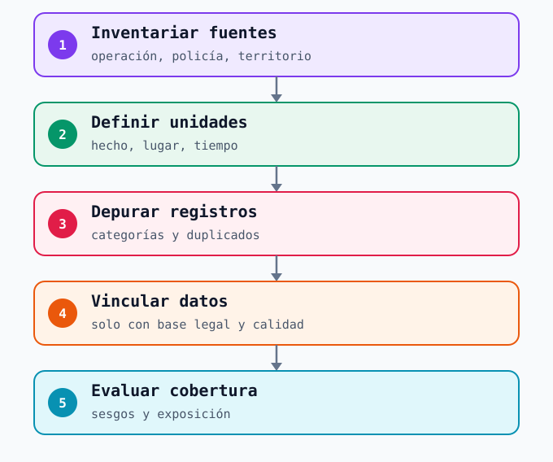
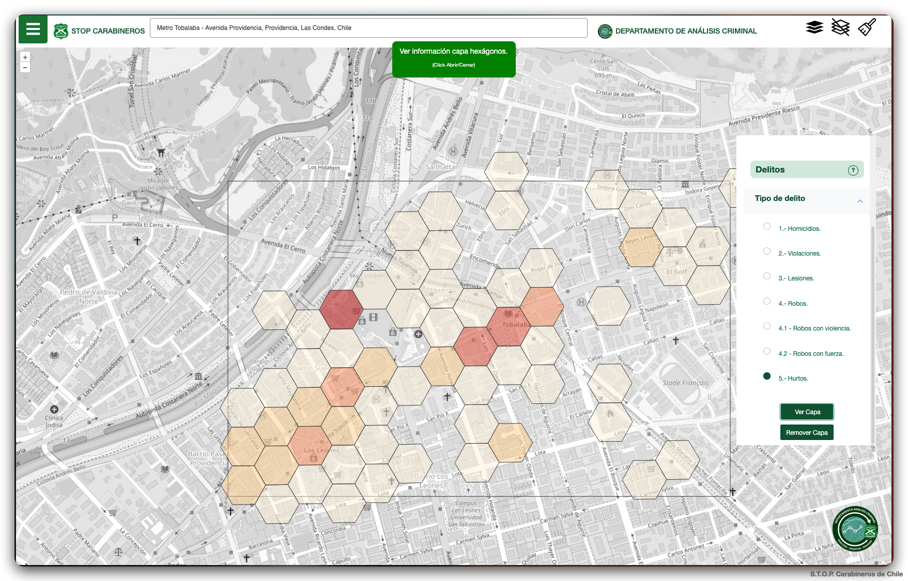
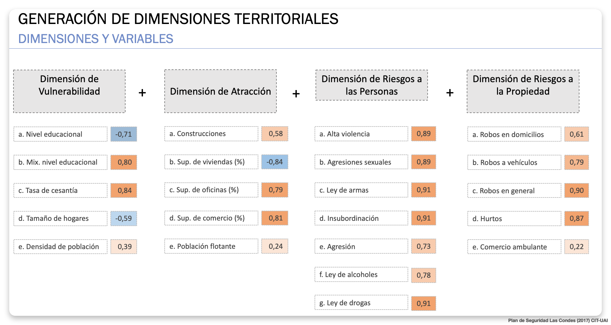

# Datos de seguridad {#sec-datos}

El bloque anterior mostró que una medida preventiva necesita un problema y un mecanismo bien definidos. Los datos permiten examinar si ese problema aparece, dónde y en qué momentos. Para Metro, la dificultad es reunir señales producidas con propósitos distintos —operar el servicio, atender usuarios, registrar denuncias o describir el entorno— sin tratarlas como si fueran el mismo hecho.

## La importancia de los datos de seguridad

Una denuncia, un aviso del personal, una alerta tecnológica y un relato de acoso son **registros**, no copias completas de lo ocurrido. Cada uno tiene una definición, un canal de entrada, una ubicación y una probabilidad diferente de quedar registrado. Si se suman sin revisar esas diferencias, una estación con más canales de reporte podría parecer más insegura solo porque observa mejor. En cambio, registros comparables permiten distinguir un problema recurrente de una variación en la detección y fundamentar dónde conviene mirar primero.

La pregunta determina el dato. Para estudiar hurtos interesa separar hechos denunciados, avisos operacionales y momentos de alta afluencia. Para examinar acoso importa también la facilidad de pedir ayuda y la protección de los relatos. Para observar comercio ambulante no permitido interesa distinguir los avisos sobre ocupación del espacio de los delitos registrados en su entorno. Para analizar circulación en un acceso, el flujo peatonal y la observación del espacio pueden ser más informativos que un total comunal de delitos. En todos los casos se debe conservar **tipo de hecho, fecha, franja, lugar de ocurrencia, lugar del aviso, fuente y precisión de la ubicación**.

{#fig-datos width="100%"}

Esta secuencia sirve también cuando el volumen es grande. Un proceso reproducible de **captura → homologación → deduplicación → vinculación → revisión de cobertura** evita multiplicar errores entre millones de registros. El algoritmo ayuda a procesar; la definición del hecho, el ámbito y el uso permitido de cada fuente siguen siendo decisiones humanas e institucionales. El resultado útil es una base cuyas limitaciones se pueden explicar, no un número aparentemente preciso sin procedencia.

## Datos de seguridad externos y vinculación espacial

Las fuentes externas describen hechos o percepciones observados **fuera del sistema operacional de Metro**. El [Centro de Estudios y Análisis del Delito (CEAD)](https://www.chileatiende.gob.cl/fichas/114579-centro-) publica estadísticas para conocer tendencias y contextos territoriales. El [Sistema Táctico de Operación Policial (STOP) de Carabineros](https://stop.carabineros.cl/) permite consultar información policial territorial; la [Ley 21.332](https://www.diariooficial.interior.gob.cl/publicaciones/2021/06/11/42976/01/1959731.pdf) describe su función de analizar tendencias, volúmenes y cambios delictuales. Son fuentes para contrastar el **entorno** de una estación; una cifra comunal o una celda policial no identifica automáticamente un hecho dentro de un andén.

{#fig-stop-tobalaba width="100%"}

La captura ilustra una categoría policial y un área próxima a Metro Tobalaba. No indica cuántos hurtos ocurrieron **dentro** de la estación ni permite calcular el riesgo de sus pasajeros. Antes de comparar esa capa con reportes internos habría que conocer el periodo, la definición de «hurto», qué representa cada hexágono, la precisión de la ubicación y las diferencias en la propensión a denunciar. Una coincidencia visual es una **pista para investigar**, no la prueba de que ambos sistemas registraron el mismo episodio.

### Vincular hechos, periodos y territorios

Vincular espacialmente no significa poner capas una encima de otra. Primero se define la unidad de decisión: estación, acceso, tramo de calle o entorno caminable. Después se comprueba qué geometría entrega cada fuente —punto, calle, hexágono, sector o comuna— y qué periodo cubre. Un dato agregado a una comuna puede describir el contexto de varias estaciones; no se reparte proporcionalmente entre sus accesos. Un registro en una celda alrededor de la estación tampoco puede asignarse sin más al recinto. Para estudiar el borde exterior, la distancia de recorrido y las barreras físicas pueden ser más pertinentes que un círculo trazado en línea recta.

La vinculación de registros individuales requiere además **definiciones equivalentes, una regla de deduplicación y un cauce autorizado de intercambio**. Una [evaluación oficial de la Dirección de Presupuestos](https://www.dipres.gob.cl/597/articles-308399_informe_final.pdf) documenta que un trabajo de la Subsecretaría de Prevención del Delito con el CIT-UAI combinó variables delictuales y de caracterización territorial para segmentar el país en **5.144 sectores** y focalizar programas barriales. Es una integración realizada para un propósito institucional definido; **no implica acceso público a los registros individuales ni una autorización equivalente para Metro**.

### Alcance de la Ley 21.659

La [Ley 21.659 sobre Seguridad Privada](https://www.bcn.cl/leychile/navegar?idNorma=1202067) contempla deberes específicos para las **entidades declaradas obligadas**. El artículo 7 exige una resolución para esa declaración; por ello, este libro **no presupone que Metro tenga tal condición**. Si una entidad está comprendida en el régimen, el artículo 13 exige un estudio de seguridad y el [artículo 15 del reglamento, Decreto 209](https://www.bcn.cl/leychile/navegar?idNorma=1213672), dispone identificar riesgos por instalación y, cuando corresponda, un plan por sucursal o instalación.

La ley **no establece que el CEAD deba entregar microdatos para esos estudios**. El artículo 5 prevé información de seguridad que las policías pueden proporcionar a entidades obligadas y municipios para evaluar riesgos. El artículo 6 regula ciertos envíos desde la entidad obligada hacia el Ministerio Público y las policías, previo requerimiento, y permite convenios de transmisión con las policías. Son mecanismos formales y condicionados; no habilitan una unión general de bases personales. Además, el artículo 21 de la ley y el artículo 20 del reglamento establecen secreto para el estudio de seguridad y sus documentos fundantes cuando ese régimen aplica. Antes de cualquier intercambio operativo se debe precisar finalidad, base jurídica, contraparte, acceso, calidad y seguridad de los datos.

## Datos de seguridad internos de Metro

Para estudiar el interior de la red se necesitan registros con la resolución de la operación. La tabla siguiente enumera **fuentes posibles**, sujetas a disponibilidad y protocolos de Metro; no afirma que la empresa conserve todos estos campos ni que puedan compartirse libremente.

| Fuente interna posible | Qué podría aportar | Precaución principal |
|---|---|---|
| Avisos e incidentes operacionales | Tipo de situación, hora, estación y sector reportado. | Un hecho puede originar varios avisos; el lugar del aviso puede diferir del lugar del hecho. |
| Canales de ayuda, reclamos o denuncias recibidas | Experiencia de usuarios y tiempo de respuesta. | Hay subregistro; los relatos sensibles requieren acceso restringido y protección de identidad. |
| Alertas de cámaras o videoanalítica, si se usan para este fin | Señales de detección y secuencia de respuesta. | Una alerta no equivale a un delito confirmado; importan cobertura y falsos avisos. |
| Validaciones, conteos de flujo y cambios de servicio | Exposición aproximada, afluencia y alteraciones de la operación. | Una validación no es una persona única ni mide por sí sola el flujo de cada pasillo o acceso. |
| Observaciones de personal y recorridos de terreno | Uso efectivo del espacio, obstáculos y hechos no captados por sistemas. | Se necesita un protocolo comparable entre días, horarios y observadores. |

: Inventario docente de posibles fuentes operacionales; su existencia y uso deben verificarse con Metro. {#tbl-fuentes}

### Cobertura, denominadores y calidad

El **conteo** responde cuántos hechos se registraron; una **tasa** relaciona ese conteo con la población o el flujo expuesto en el mismo lugar y periodo. El [Center for Problem-Oriented Policing](https://popcenter.asu.edu/content/step-27-know-how-use-rates-and-denominators) explica por qué un lugar con más usuarios puede acumular más hechos sin presentar mayor riesgo por persona expuesta. En Metro, las validaciones podrían aproximar exposición para algunos eventos de estación, siempre que se revisen transbordos, entradas, salidas y el lugar real del hecho. Para un acceso o una calle puede hacer falta un conteo peatonal distinto.

El [conjunto oficial de datos de delitos en el transporte de Londres](https://www.data.gov.uk/dataset/a2fe2323-ab08-4040-843e-1615046e3542/transport-crime-in-london1) combina registros policiales con viajes de pasajeros y publica volúmenes y tasas por millón de viajes. Su ficha advierte diferencias de registro entre modos y revisiones de las cifras mensuales. Es un ejemplo de **denominador y definición publicados junto al resultado**, no una tasa trasladable a Metro de Santiago.

Antes de comparar estaciones o franjas, hay que revisar **faltantes, duplicados, cambios de categoría, cobertura de cámaras o personal y calidad de la localización**. Un aumento posterior a un nuevo canal de denuncia puede reflejar mayor facilidad para reportar. Si un registro solo identifica la estación, permite una comparación a esa escala; no respalda un foco dibujado en un pasillo. Cuanto más masivo sea el procesamiento, más importante es conservar versiones de las definiciones y controles de calidad reproducibles.

::: {.callout-note title="Información sensible"}

El libro usa fuentes públicas y ejemplos sin vulnerabilidades identificables de instalaciones reales. Para trabajar con relatos de víctimas, imágenes o registros individuales se necesita finalidad definida, acceso controlado y revisión de los protocolos de Metro. Para la clase prevista en noviembre de 2026 rige la [Ley 19.628](https://www.bcn.cl/leychile/Navegar?dt=open&idLey=19628); la [Ley 21.719](https://www.bcn.cl/leychile/navegar?idNorma=1209272) tiene entrada en vigencia general el **1 de diciembre de 2026**. Un proyecto que continúe después de esa fecha requiere revisar el régimen aplicable con el equipo jurídico y de protección de datos.
:::

## Datos de contexto territorial

Los datos de contexto ayudan a describir **qué rodea una estación y quiénes podrían usar ese espacio**. Incluyen condiciones residenciales, equipamientos, actividad económica, accesibilidad y ambiente. No son reportes de incidentes de Metro y no sustituyen el conteo de usuarios. La [ENUSC del INE](https://www.ine.gob.cl/estadisticas-por-tema/sociedad-y-condiciones-de-vida/seguridad-ciudadana) aporta victimización y percepción a las escalas para las que publica resultados; [IDE Chile](https://www.ide.cl/) permite localizar capas y metadatos geoespaciales. Una encuesta de hogares o un promedio comunal sitúa el contexto, pero no mide la experiencia de quienes viajan por un acceso concreto.

### Matriz de Bienestar Humano Territorial del CIT-UAI

La [Matriz de Bienestar Humano Territorial (MBHT)](https://cit.uai.cl/plataforma-bht-de-la-uai-se-actualiza-con-datos-y-nuevas-herramientas-para-decisiones-basadas-en-evidencia-en-los-territorios/), desarrollada por el Centro de Inteligencia Territorial de la UAI con Subdere, organiza indicadores en cuatro dimensiones: **accesibilidad, socioeconómica, ambiental y seguridad**. La [plataforma pública(](https://matrizbht.cl/) permite examinar diferencias territoriales con detalle que puede llegar a la manzana urbana o entidad mínima rural. Para usarla en torno a Metro hay que revisar la ficha del indicador, el año de los datos y la unidad espacial antes de relacionarla con una estación o su entorno caminable.

| Dimensión MBHT | Qué describe | Lectura posible para Metro y límite |
|---|---|---|
| Socioeconómica | Condiciones residenciales como vivienda, educación y empleo. | Ayuda a comprender brechas del entorno; no caracteriza automáticamente a pasajeros ni identifica autores de hechos. |
| Seguridad | Indicadores territoriales construidos con categorías de casos policiales. | Sitúa riesgos del entorno; si se combina con CEAD o STOP, hay que comprobar años y fuentes para evitar reutilizar los mismos hechos como resultado y explicación. |
| Accesibilidad | Acceso de la población a equipamientos y servicios. | Describe oportunidades y recorridos del entorno; no mide por sí sola el acceso físico ni el flujo dentro de Metro. |
| Ambiental | Condiciones del hábitat, como cobertura vegetal y temperatura superficial en la metodología publicada. | Ayuda a describir el espacio público; una asociación con incidentes no demuestra causalidad. |

: Uso introductorio de las cuatro dimensiones de la MBHT. La definición de indicadores y sus años deben verificarse en las [notas metodológicas de Subdere](https://plataformabht.subdere.gov.cl/assets/files/notas-metodologicas.pdf) y en la versión consultada de la plataforma. {#tbl-mbht-metro}

La MBHT puede ayudar a comparar **entornos diferentes de estaciones**, no a asignar automáticamente un nivel de riesgo a cada estación. En particular, su dimensión de seguridad puede usar registros policiales semejantes a los de otra fuente externa: sumarla sin revisar procedencia produciría una falsa sensación de corroboración. Las condiciones socioeconómicas describen residentes del área, mientras la demanda de Metro incluye personas que llegan desde otros lugares.

### SII, comercio, oficinas y población flotante

Las [estadísticas de empresas del Servicio de Impuestos Internos (SII)](https://www.sii.cl/sobre_el_sii/estadisticas_de_empresas.html) publican número de empresas y trabajadores dependientes, entre otras variables, con desagregaciones **por comuna y por actividad económica**. Sirven para describir la estructura económica comunal: comercio y actividades de servicios asociadas a oficinas pueden sugerir zonas con viajes por trabajo o compras. Es una **hipótesis sobre atractores**, no una medición directa de población flotante.

El propio SII indica que la ubicación geográfica de esas estadísticas se asigna según el **domicilio o casa matriz** informado al servicio, y que algunas celdas se reservan por secreto tributario. Por ello, los totales comunales no localizan todos los locales, sucursales u oficinas en el entorno caminable de una estación. Dos estaciones de una misma comuna recibirían el mismo total del SII aunque sus accesos den a espacios comerciales muy distintos. Para aproximar atractores a escala de acceso haría falta un catastro georreferenciado de establecimientos y usos del suelo, con procedencia y permiso de uso claros; para medir flujo real, se necesitan validaciones, conteos peatonales u observación comparable.

### Variables para un diagnóstico de seguridad

Un diagnóstico debe seleccionar variables según el problema que quiere explicar y la escala en que se decidirá una respuesta. La siguiente lámina de un estudio histórico del **CIT-UAI para Las Condes** muestra una forma de organizarlas: vulnerabilidad y atracción urbana describen condiciones del territorio; riesgos a las personas y a la propiedad distinguen fenómenos de seguridad. Es una clasificación de **ese proyecto**, diferente de las cuatro dimensiones de la MBHT presentadas arriba.

{#fig-variables-las-condes width="100%"}

La lámina incluye superficie de oficinas y comercio, población flotante, hurtos y comercio ambulante. Ayuda a formular preguntas para el entorno de Metro: qué actividades atraen viajes, qué hechos se busca observar y si cada dato existe con una localización y fecha compatibles. Los números impresos pertenecen a la presentación original; **sin ficha técnica no se interpretan como efectos causales ni como valores aplicables a estaciones actuales**. El caso se retoma en [Modelamiento espacial](06d-modelamiento.qmd), donde se examina una segunda lámina de resultados.

Con estas distinciones, el capítulo siguiente puede buscar concentraciones sin confundir **hechos registrados, exposición y condiciones del territorio**. Continúe con [Análisis espacial](06c-lectura-espacial.qmd).
