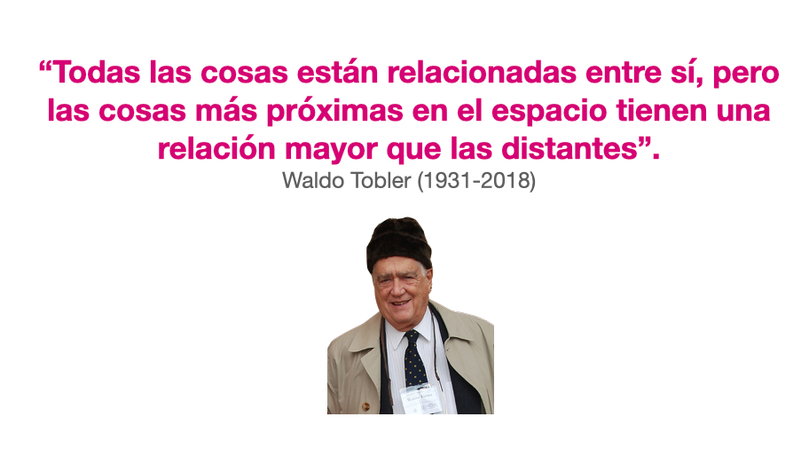
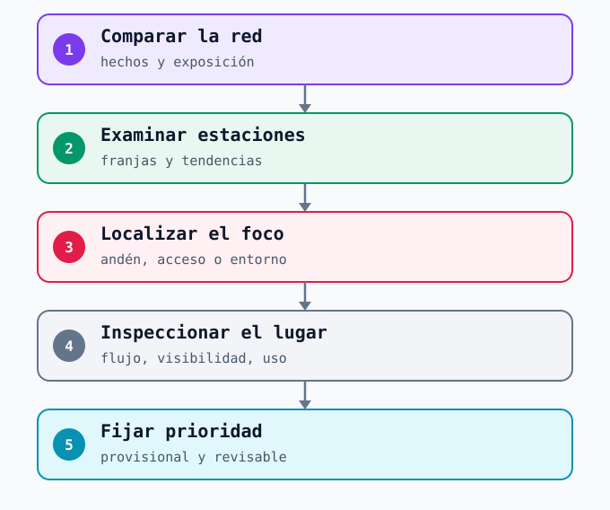
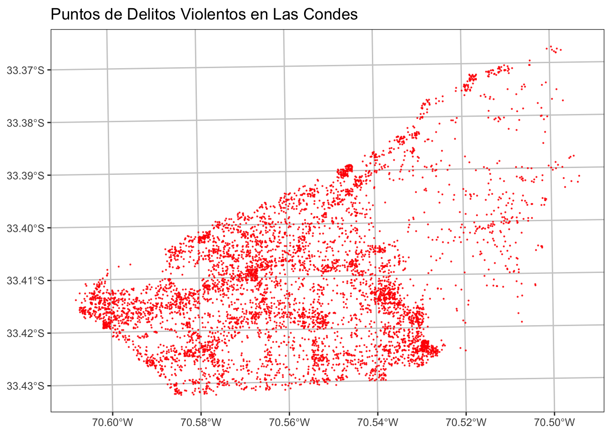
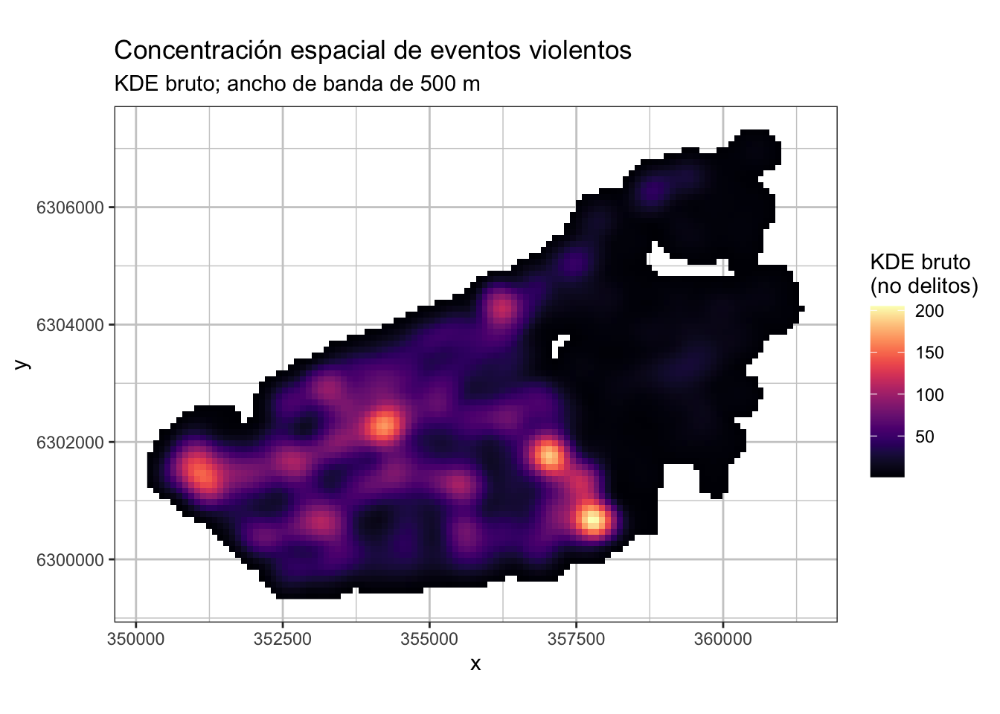
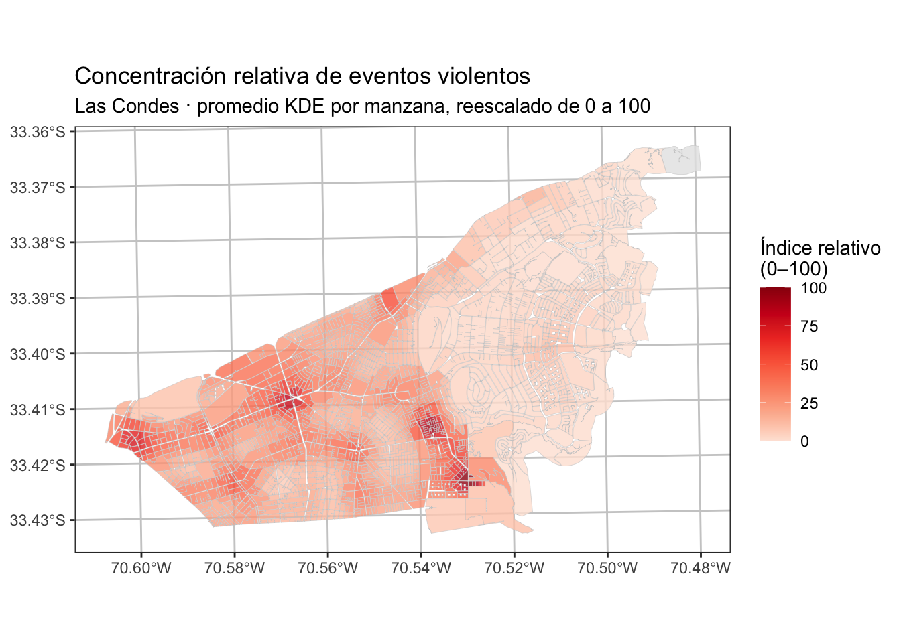

# Análisis espacial {#sec-lectura-espacial}

Una vez definidos los registros, el mapa ayuda a **localizar preguntas**. Una concentración de hechos registrados, o *hotspot*, señala dónde conviene investigar primero. Todavía no indica por qué ocurre el problema ni qué medida funcionará. En una red como Metro, además, la lectura cambia si la unidad es la estación completa, un acceso, un pasillo, el andén o el entorno caminable.

{#fig-tobler width="72%"}

*Nota editorial:* la lámina indica 1931 como año de nacimiento; el [obituario académico de Tobler](https://www.tandfonline.com/doi/full/10.1080/15230406.2018.1447399) registra **1930–2018**.

La primera ley de Tobler [@Tobler_1970] propone que las cosas próximas tienden a estar más relacionadas que las lejanas. En análisis espacial, es una **hipótesis sobre dependencia y semejanza espacial**: vale la pena comprobar si unidades vecinas comparten patrones antes de agruparlas o estimar una superficie entre observaciones. La cercanía, sin embargo, **no garantiza igualdad ni define por sí sola un territorio**. Para Metro, dos estaciones cercanas pueden diferir por transbordos, flujo, usos del entorno o barreras físicas; y dos accesos de la misma estación pueden tener condiciones distintas. Por eso la vecindad debe definirse según la pregunta —distancia caminable, conexión de la red, tiempo de viaje o continuidad del espacio— y contrastarse con los registros y la observación.

## Del mapa de Chile al espacio de una estación

Un mapa comunal del CEAD o una estimación regional de la ENUSC puede describir el contexto urbano de una estación. Para orientar una acción en un acceso se necesita otra resolución: el **lugar efectivo del hecho**, una **franja temporal** pertinente y una observación del uso del espacio. La misma regla se aplica al tiempo. Una cifra trimestral puede ocultar una concentración en determinados días u horarios; una hora aislada puede exagerar una variación casual.

El [Center for Problem-Oriented Policing](https://popcenter.asu.edu/content/step-23-diagnose-your-hot-spot) recomienda examinar qué ocurre *dentro* de un foco identificado. En Metro eso significa volver del mapa a la operación: recorrer el lugar, comprobar visibilidad, circulación, señalización, posibilidad de pedir ayuda y cambios de servicio. El mapa inicia la inspección; no la sustituye.

La lectura espacial parte de los criterios de calidad revisados en el bloque anterior. Solo se representa a la escala que admite el registro: **estación, acceso, tramo de calle o punto interior**. Una ubicación aproximada nunca se presenta como coordenada exacta. También se mantiene constante la definición del hecho; un mapa de todos los avisos mezclados dificulta decidir qué mecanismo preventivo examinar.

## Cuatro lecturas en orden

{#fig-espacial width="100%"}

1. **Ubicar.** ¿El punto marcado corresponde al hecho, al aviso o a la intervención del equipo? ¿Qué precisión tiene?
2. **Contar.** ¿Cuántos hechos comparables se registraron por estación, acceso o segmento y durante qué periodo?
3. **Relacionar con exposición.** ¿El lugar con más reportes también recibió más personas? Compare tasas solo cuando hecho y denominador cubran el mismo espacio y tiempo.
4. **Comprobar persistencia.** ¿La concentración aparece en varias semanas o se explica por un evento excepcional, un cambio de registro o una obra?

| Vista | Qué revela | Pregunta que deja abierta |
|---|---|---|
| Conteos por estación | Carga total de reportes y demanda potencial de respuesta | ¿Cuánto influye el volumen de pasajeros? |
| Tasa por exposición comparable | Diferencia relativa entre unidades | ¿Representa bien la exposición real al hecho? |
| Desglose por día y hora | Momentos de concentración | ¿Cambió el servicio o el modo de reportar? |
| Observación de un acceso o pasillo | Condiciones físicas y prácticas de uso | ¿Se repiten y están vinculadas al problema? |

: Cada vista responde una pregunta distinta; ninguna reemplaza a las demás. {#tbl-vistas}

## De los puntos a la superficie: KDE

La **estimación de densidad por kernel (KDE)** coloca una función de influencia alrededor de cada evento localizado y suma sus aportes en una cuadrícula. El resultado es una superficie suavizada que permite ver concentraciones difíciles de leer en una nube de puntos. La decisión clave es el **ancho de banda**: uno pequeño revela focos finos pero puede exagerar variaciones aisladas; uno grande une focos próximos y puede ocultar diferencias relevantes. También importan el tamaño de celda, el límite del área y la calidad de las coordenadas. La [documentación de QGIS](https://docs.qgis.org/3.44/en/docs/user_manual/plugins/plugins_interpolation.html) describe estos parámetros para su herramienta de mapas de calor, y el [National Institute of Justice](https://nij.ojp.gov/sites/g/files/xyckuh171/files/media/document/CrimeStat%2520IV%2520Chapter%25202.pdf) explica su uso en análisis delictual.

Las tres imágenes siguientes proceden de una **demostración metodológica con ubicaciones espacialmente anonimizadas de eventos violentos en Las Condes**. Muestran una secuencia de análisis; no son un diagnóstico actual de la comuna ni datos de incidentes de Metro.

**1. Examinar los puntos.** Antes de suavizar, se comprueban el ámbito, la precisión y la posible acumulación de registros en lugares de denuncia en vez de ocurrencia. La figura muestra la distribución de los eventos utilizados en el ejemplo, pero no permite identificar por sí sola una tasa ni el mecanismo de cada hecho.

{#fig-kde-puntos width="82%"}

**2. Estimar la superficie.** La demostración aplica un kernel cuártico con **ancho de banda de 500 m** sobre celdas de **100 m**. Las zonas claras de la figura representan mayor suma de aportes cercanos. Los valores del «KDE bruto» no son números de delitos, probabilidades individuales ni tasas de victimización; cambiar los parámetros cambia la superficie.

{#fig-kde-superficie width="82%"}

**3. Resumir por una unidad de decisión.** El valor KDE se promedió dentro de cada manzana y luego se reescaló entre 0 y 100 **para este conjunto de manzanas**. Así se comparan posiciones relativas dentro del mismo ejemplo. Un valor 80 no significa 80 delitos ni que el riesgo individual sea el doble que en una manzana con valor 40. El promedio tampoco equivale al número de hechos ocurridos dentro de la manzana.

{#fig-kde-manzanas width="82%"}

La **lógica del método es independiente del programa**. En [QGIS](https://docs.qgis.org/3.44/en/docs/user_manual/plugins/plugins_interpolation.html) se configura la capa de puntos, el radio y la resolución; en R, [`SpatialKDE`](https://cran.r-project.org/web/packages/SpatialKDE/refman/SpatialKDE.html) permite definir banda, kernel y cuadrícula; en Python, [`scipy.stats.gaussian_kde`](https://docs.scipy.org/doc/scipy/reference/generated/scipy.stats.gaussian_kde.html) estima una densidad multidimensional que el analista debe llevar a una grilla y una cartografía adecuadas. También existen herramientas SIG como [Kernel Density de ArcGIS Pro](https://pro.arcgis.com/en/pro-app/3.6/tool-reference/spatial-analyst/how-kernel-density-works.htm). **Las salidas numéricas de estas implementaciones no se comparan directamente** sin revisar kernel, normalización, unidades y parámetros.

Para un entorno de estación, primero hay que decidir si interesa la calle, los accesos o el interior. Una banda de 500 m, útil para ilustrar un sector comunal, mezclaría varios microespacios de una estación; la distancia en línea recta puede unir lugares separados por vías, muros o niveles. Si se necesita representar circulación, conviene evaluar distancia de recorrido o análisis sobre la red. En cualquier caso, el KDE indica **dónde inspeccionar** y con qué incertidumbre; no identifica la causa ni prescribe una intervención.

## Técnicas complementarias y límites

Una **cuadrícula o agrupación por segmentos** facilita comparar lugares con una unidad estable. Los **perfiles por día y hora** muestran si una concentración espacial coincide con una rutina operativa. Finalmente, superponer capas de flujos, accesos, equipamientos o vulnerabilidad territorial ayuda a formular hipótesis; la coincidencia en el mapa todavía no demuestra una causa.

Un *hotspot* es una **concentración relativa a una unidad, un periodo y una definición de hecho**. Su posición puede cambiar al agrupar por estación, acceso o cuadrícula; una [investigación publicada por el NIJ](https://nij.ojp.gov/library/publications/do-crime-hot-spots-move-exploring-effects-modifiable-areal-unit-problem-and) estudió precisamente cómo el tamaño de celda y del periodo alteran la estabilidad medida de los focos. Por eso se debe comprobar si la prioridad se mantiene con otra agregación razonable y con otro periodo. El [manual de análisis de focos del Center for Problem-Oriented Policing](https://popcenter.asu.edu/content/tool-guides-crime-and-disorder-hot-spots) propone pasar de localizar el foco a investigar sus causas inmediatas y respuestas específicas. Para Metro, eso implica comprobar primero en terreno si la concentración coincide con flujos, cambios de servicio, puntos de espera o condiciones de supervisión.

Como **ejemplo comparado**, la [Alcaldía de Londres informó en 2024 que existían mapas delictuales por estación de la policía británica de transporte](https://www.london.gov.uk/who-we-are/what-london-assembly-does/questions-mayor/find-an-answer/station-crime-1). Esa escala ferroviaria sirve para iniciar preguntas; una estación completa todavía es demasiado amplia para afirmar en qué pasillo ocurrió un hecho. Este límite se parece al que enfrenta cualquier análisis de Metro cuando la localización registrada es incompleta.

La [evaluación de programas de prevención situacional de la Dirección de Presupuestos](https://www.dipres.gob.cl/597/articles-308399_informe_final.pdf) muestra por qué importa la unidad espacial: describe barrios residenciales y comerciales delimitados para programas territoriales, y también puntos críticos de menor extensión para Calle Segura, entre cuyos ejemplos menciona **salidas de Metro**. Son diagnósticos para decisiones distintas. Un polígono barrial puede orientar coordinación territorial, pero no localiza por sí mismo el acceso ni el pasillo donde ocurrió un hecho.

Para Metro, la técnica se escoge según la decisión: una cuadrícula del entorno puede servir para coordinar una inspección con el municipio; un desglose por pasillo y franja exige registros internos de mayor precisión. El resultado debe ser legible para quien decide y reproducible por quien analiza.

## Ejemplo documentado: prioridades en Metro

El Gobierno Regional Metropolitano informó en febrero de 2025 que Metro reforzaría el apoyo a usuarios durante las **horas punta** y que se prestaría atención a los **accesos** [@gobiernoSantiago2025metro]. Es un **ejemplo de prioridades anunciadas**, no un mapa de incidentes. Para convertir una prioridad general de este tipo en una decisión territorial verificable, propondríamos una secuencia de análisis:

- **Red:** identificar qué tipo de problema específico se quiere reducir y en qué estaciones se registra con una definición estable.
- **Estación:** comparar volumen de reportes, flujo y cambios de operación durante periodos equivalentes.
- **Acceso y franja:** ubicar los hechos con precisión suficiente, observar el espacio y distinguir el interior de la superficie.

Esta secuencia es una **propuesta metodológica para la clase**. La fuente citada no entrega la tabla de incidentes y exposición que permitiría construir esos mapas. Por eso, aquí no elegimos una estación prioritaria ni dibujamos un foco delictual ficticio sobre una estación real.

::: {.callout-warning}
## Tres errores que cambian la decisión

- **Mezclar ámbitos:** sumar un hecho de la calle a los del interior y dividirlo por validaciones de estación.
- **Confundir carga y riesgo:** elegir solo por conteos sin examinar cuántas personas circularon.
- **Convertir una coincidencia en causa:** atribuir a la iluminación, al comercio o al diseño un patrón que aún no se ha investigado en terreno.
:::

## Ejemplo de lectura previa a una inspección

Para estudiar sustracciones dentro de estaciones, un mapa de conteos por estación puede mostrar diferencias generales. Si los registros permiten localizar hechos con mayor precisión, otro mapa podría mostrar su distribución dentro del ámbito elegido. Una tabla de «reportes de sustracción por semana y franja horaria, comparados con validaciones del mismo periodo» aclararía el denominador y la cobertura. Incluso ante una concentración visible habría que considerar explicaciones alternativas, como cambios en el flujo, el servicio o la facilidad para reportar. La inspección del lugar ayuda a evaluar el mecanismo antes de proponer una medida.

El resultado de esa lectura sería una prioridad **provisional** de lugares y horarios, acompañada de incertidumbre. A partir de ella corresponde volver al mecanismo preventivo antes de elegir una medida.

## Del foco a la prevención situacional

Aquí el análisis vuelve a los [enfoques de prevención](06a-enfoques-preventivos.qmd). Su aporte más directo a la **prevención situacional** es precisar *dónde, cuándo y para qué hecho* conviene observar una oportunidad o una condición inmediata. La ruta es **foco persistente → inspección del microespacio → mecanismo plausible → medida acotada → seguimiento**. El [Center for Problem-Oriented Policing](https://popcenter.asu.edu/content/step-23-diagnose-your-hot-spot) recomienda diagnosticar qué sucede dentro de un foco antes de elegir la respuesta.

Por ejemplo, **si** avisos comparables de hurto se concentraran en un acceso durante la hora punta, Metro podría revisar allí circulación, visibilidad, espera y posibilidad de pedir ayuda. Solo si la observación sostiene una hipótesis concreta tendría sentido probar un ajuste de orientación, supervisión o flujo y seguir el problema con una referencia comparable, considerando cambios en afluencia y reporte. El mapa no elige por sí solo cuál de esas medidas corresponde. Si el foco está en la calle exterior, la acción situacional necesitaría coordinación con el actor responsable de ese espacio; un patrón compartido con residentes y usuarios también puede abrir una ruta comunitaria. El [modelamiento espacial](06d-modelamiento.qmd) pregunta si, además del lugar, hay **factores territoriales asociados** que convenga examinar.
