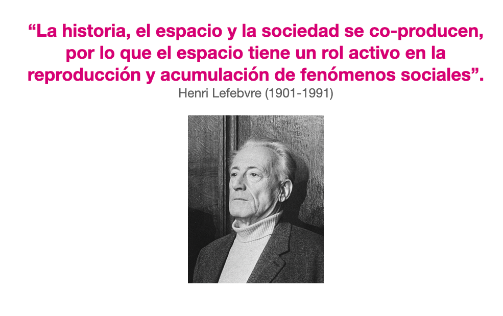
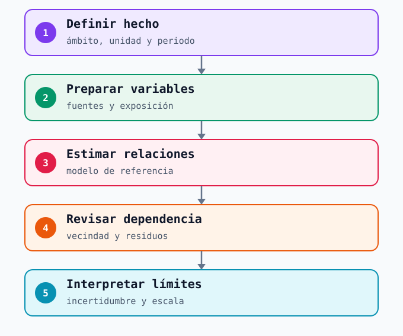
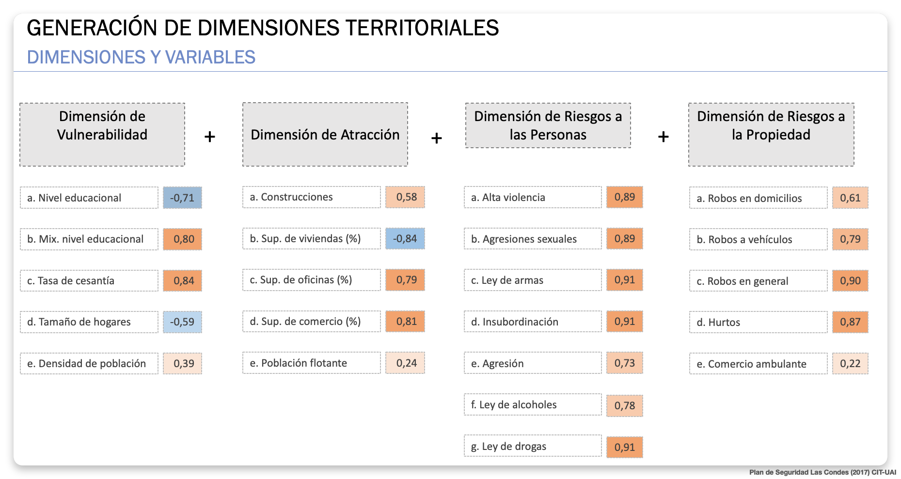
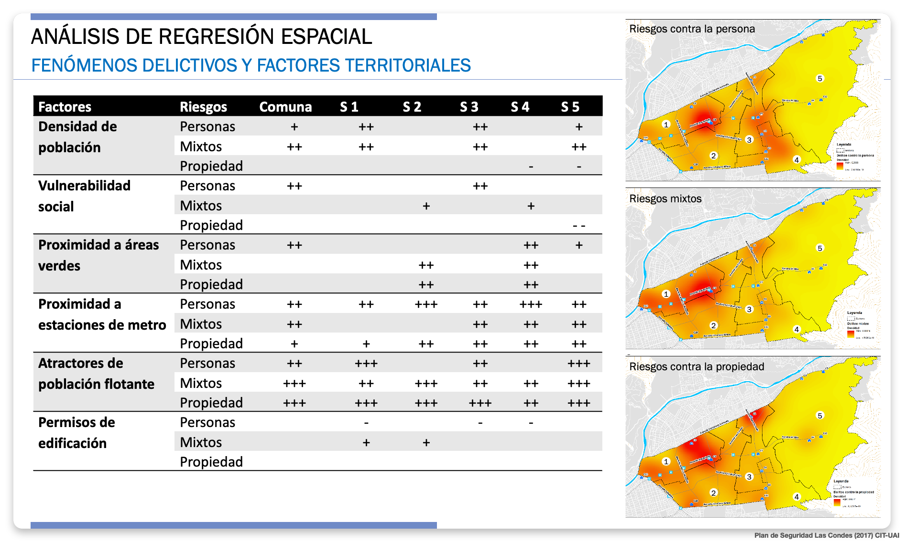

# Modelamiento espacial {#sec-modelamiento}

El [análisis espacial](06c-lectura-espacial.qmd) permite reconocer dónde se concentran hechos registrados. El modelamiento plantea una pregunta distinta: **¿cómo se relaciona esa distribución con las características del territorio?** Una regresión puede comparar asociaciones entre lugares y examinar si quedan patrones espaciales sin explicar. Sus resultados ayudan a formular preguntas más precisas; por sí solos no identifican causas ni prueban que una medida vaya a cambiar la ocurrencia de delitos.

{#fig-lefebvre width="72%"}

La idea de **producción social del espacio** de Lefebvre [@Lefebvre_1974] recuerda que los lugares se configuran mediante actividades, infraestructuras y relaciones entre personas. Una estación y su entorno reúnen flujos, horarios, comercios, viviendas y espacios públicos. Esa diversidad justifica estudiar variables territoriales, siempre con una unidad y una fecha compatibles con el hecho observado. No convierte una característica social del área en atributo de cada pasajero o residente.

## Definir qué se quiere explicar

Antes de elegir un algoritmo hay que definir el **resultado**: por ejemplo, una categoría de hurtos registrados en el entorno exterior de estaciones durante un periodo comparable. Los avisos internos de Metro, las denuncias policiales del exterior y los relatos de acoso responden a sistemas distintos; mezclarlos produciría un resultado difícil de interpretar. El ejemplo es una pregunta docente, **no un análisis realizado con datos de Metro**.

| Decisión de diseño | Pregunta para el analista | Límite que debe quedar explícito |
|---|---|---|
| Resultado y periodo | ¿Qué hecho se cuenta y en qué meses o franjas? | Cambios en la denuncia o en el registro pueden parecer cambios del problema. |
| Unidad espacial | ¿Estación, acceso, segmento de calle o entorno caminable? | Una relación a escala barrial no describe automáticamente un pasillo. |
| Variables territoriales | ¿Qué datos de flujo, comercio o condiciones del entorno corresponden a esa unidad? | Fuentes de años o escalas diferentes pueden crear asociaciones engañosas. |
| Exposición | ¿Cuántas personas estuvieron potencialmente expuestas en el mismo lugar y periodo? | Más hechos en un lugar muy concurrido no implican mayor riesgo individual. |

: Cuatro decisiones previas a un modelo que relacione hechos y territorio. {#tbl-diseno-modelo}

La [MBHT y las fuentes económicas](06b-datos-territoriales.qmd) ofrecen contexto, pero no todas alcanzan la escala de un acceso. Si el resultado es un **conteo** de hechos, modelos como [Poisson o binomial negativa](https://www.ojp.gov/library/publications/poisson-regression-modeling-crimestat-iv-spatial-statistics-program-analysis) responden a esa naturaleza y también debe considerarse la exposición. Elegir una familia para conteos y especificar la dependencia espacial son decisiones distintas: el esquema lineal de OLS, SEM y SAR que sigue **no prescribe aplicar OLS a cualquier conteo**. La pregunta, la calidad de las variables y la unidad anteceden al programa informático.

{#fig-modelamiento width="100%"}

## Regresión y dependencia espacial

Una regresión de referencia examina cómo varía el resultado entre unidades según las variables incluidas. En datos territoriales, unidades próximas pueden parecerse por condiciones compartidas o por procesos que el modelo omitió. Por eso importa definir **qué significa vecindad**: manzanas contiguas, sectores conectados a pie o estaciones relacionadas por la red no representan la misma estructura. Esa definición se resume en una matriz de pesos espaciales, $W$.

El recorrido introductorio del material docente de regresión espacial parte de una regresión ordinaria (**OLS**) como referencia para un resultado continuo, examina si sus **residuos** todavía se agrupan espacialmente —por ejemplo, con el estadístico de Moran— y solo después considera una especificación espacial. La [guía de ArcGIS Pro](https://pro.arcgis.com/en/pro-app/3.3/tool-reference/spatial-statistics/regression-analysis-basics.htm) explica el paso de describir un patrón a explorar relaciones, y por qué un modelo debe revisarse con sus diagnósticos. Un residuo es la diferencia entre lo observado y lo estimado; si los residuos próximos se parecen, la explicación aún puede ser incompleta.

| Familia | Qué incorpora | Cautela de interpretación |
|---|---|---|
| OLS, referencia | Una relación promedio para todas las unidades. | Puede dejar dependencia en los residuos u ocultar diferencias locales. |
| Error espacial (SEM) | Relación entre los errores de unidades vecinas. | Reconoce estructura no explicada, pero no identifica por sí solo el factor omitido. |
| Rezago espacial (SAR) | Relación del resultado de una unidad con los resultados de sus vecinas, según $W$. | Requiere una hipótesis de interacción; los coeficientes no se leen como efectos locales simples. |
| Modelo combinado (SAC/SARAR) | Dependencia en el resultado y en el error. | Aumenta la complejidad y exige justificar ambas estructuras con datos suficientes. |

: Panorama de familias lineales de regresión espacial, basado en [`spatialreg`](https://r-spatial.github.io/spatialreg/reference/ML_models.html) y [PySAL `spreg`](https://pysal.org/spreg/notebooks/7_spatial_models.html); no son alternativas automáticas para cualquier resultado. {#tbl-regresion-espacial}

Estas familias pueden estimarse en R o Python y explorarse en herramientas SIG, pero el diagnóstico decide si una formulación tiene sentido. **Moran significativo no obliga a escoger un modelo concreto**: también puede revelar variables omitidas, una unidad inadecuada o una vecindad mal definida. Como aproximación distinta, el [Risk Terrain Modeling](https://nij.ojp.gov/library/publications/risk-terrain-modeling-spatial-risk-assessment) combina factores del paisaje para construir una superficie de riesgo; sirve para examinar dónde coinciden condiciones seleccionadas, no para leer el efecto causal de cada una.

## Leer un resultado sin atribuir causalidad

Supongamos que, en un estudio hipotético por sectores, la superficie comercial tiene una asociación positiva con hurtos registrados. La lectura inicial sería que **los sectores con más comercio registraron más hurtos, dadas las otras variables incluidas en ese modelo**. Antes de interpretarla habría que revisar flujo de personas, oportunidades de denuncia, precisión de los hechos y compatibilidad temporal. El signo de un coeficiente tampoco dice cuánto cambiarían los hurtos si se modificara el comercio.

Una lectura responsable compara **dirección y magnitud de la asociación, incertidumbre, residuos y sensibilidad a la unidad y a la vecindad elegidas**. Si una variable de vulnerabilidad social aparece asociada con hechos de seguridad, el resultado describe áreas agregadas: **no permite inferir quién cometió un hecho ni cómo se comportan sus residentes**. Puede abrir preguntas para un análisis social o para conversaciones con actores del territorio sobre procesos que el registro no capta. Esas preguntas deben contrastarse con información cualitativa y con quienes conocen el lugar, sin convertir una correlación en una etiqueta.

La palabra «impacto» se reserva aquí para una **intervención evaluada con una comparación adecuada**. Una regresión que relaciona hechos y características del territorio estima asociaciones, aun cuando controle por otras variables y por dependencia espacial. Para atribuir a una medida un cambio posterior en los hechos habría que considerar lo que [habría ocurrido sin esa medida](https://popcenter.asu.edu/content/step-47-know-how-use-controls), además de cambios de flujo, registro y contexto.

## Caso chileno: Las Condes

La [Municipalidad de Las Condes documenta](https://archivos.lascondes.cl/descargas/transparencia/plan_desarrollo_comunal/Plan-de-Desarrollo-Comunal-2022-2025-Las-Condes.pdf) que el **Centro de Inteligencia Territorial de la Universidad Adolfo Ibáñez** realizó en el primer semestre de **2018** una investigación sobre fenómenos sociodelictuales de la comuna y sus diferencias internas. Las láminas docentes del proyecto incluidas aquí llevan en su pie «Plan de Seguridad Las Condes (2017)»: se conserva la fecha impresa sin confundirla con la presentación municipal de 2018.

La primera lámina, ya presentada en el [capítulo de datos](06b-datos-territoriales.qmd), agrupa variables de **vulnerabilidad** y **atracción urbana** junto con categorías de **riesgos a las personas y a la propiedad**. Ayuda a distinguir factores territoriales de resultados de seguridad antes de estimar relaciones. Es una clasificación de ese diagnóstico, distinta de las dimensiones de la MBHT; los valores impresos en la imagen no tienen una ficha técnica suficiente para interpretarlos aquí como efectos.

{#fig-dimensiones-las-condes width="100%"}

La segunda lámina presenta signos de asociación para **riesgos a las personas, mixtos y a la propiedad** a escala comunal y en cinco sectores, además de mapas. Permite ver la pregunta que motiva un modelo espacial: **¿se mantiene igual una relación en toda la comuna y en cada sector?** Sin coeficientes, intervalos de incertidumbre, definición completa de las unidades y diagnósticos del ajuste, los signos no permiten medir magnitudes ni verificar el modelo. Son una síntesis histórica del proyecto, no resultados reproducidos para este libro.

{#fig-regresion-las-condes width="100%"}

Las [conclusiones originales del proyecto](images/plan-seguridad-conclusiones.png) señalaron dos problemas territoriales diferentes: riesgos a la propiedad asociados a centralidades comerciales y flujos de población flotante en el eje Apoquindo–Las Condes, incluidos entornos de estaciones de Metro; y riesgos a las personas en torno al Parque Los Dominicos y áreas aledañas de mayor vulnerabilidad. El interés analítico está en **no tratar ambos fenómenos como un único promedio comunal**. Son interpretaciones del estudio de esa época; no describen la seguridad actual de esas estaciones ni prueban que las variables hayan causado los hechos.

## Alcance para Metro

Para Metro, un modelo territorial podría ayudar a contrastar si distintos tipos de reportes se relacionan de manera diferente con afluencia, usos comerciales y características sociales del entorno. Esa comparación exige separar **interior de la estación, accesos y espacio exterior**, además de contar con resultados y factores medidos en la misma escala y periodo. Si los datos solo identifican una estación, no respaldan una asociación a escala de pasillo.

Una relación con características sociales puede orientar **dónde profundizar un diagnóstico** con instituciones y actores comunitarios; no determina una intervención ni caracteriza a las personas que usan Metro. Una relación con atractores comerciales puede motivar la revisión de exposición y actividades del entorno antes de sacar conclusiones. En ambos casos, el modelo es una fuente de preguntas para el análisis territorial, que se contrasta con registros, observación y conocimiento local.

La [conclusión del libro](conclusiones.qmd) reúne lo aprendido en los cuatro bloques y deja la decisión y su seguimiento como trabajo posterior. Esta sesión introductoria presenta criterios de lectura; estimar y validar un modelo para Metro requeriría datos, permisos y un estudio específico.
