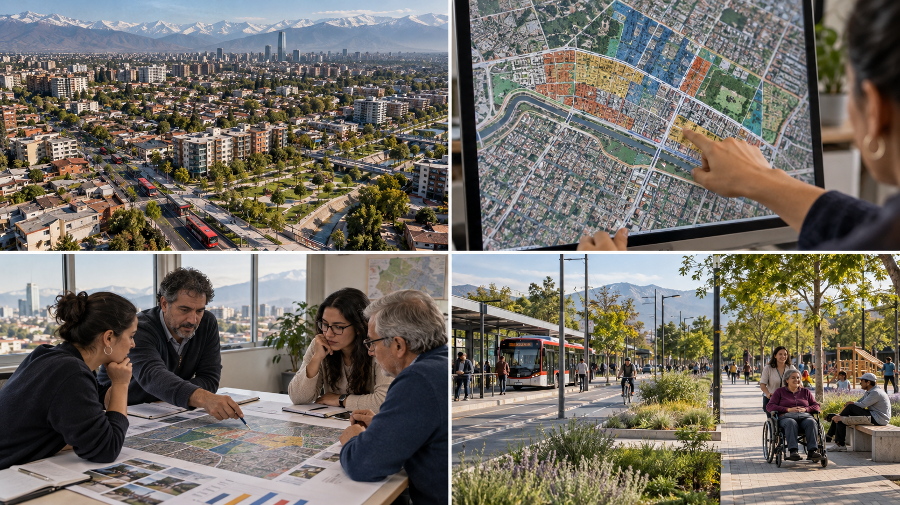

# Conclusiones {.unnumbered #sec-conclusiones}

La pregunta que abrió este libro fue **cómo convertir información dispersa en una decisión preventiva concreta, justificable y revisable**. Los cuatro bloques ofrecen una respuesta encadenada. Cada uno resuelve una parte del problema y deja una pregunta precisa para el siguiente:

| Bloque | Lo que aporta | Pregunta que deja para avanzar |
|---|---|---|
| Enfoques de prevención | Identificar el mecanismo que se quiere modificar y distinguir respuestas situacionales, sociales y comunitarias. | ¿Qué evidencia permitiría reconocer ese problema y su contexto? |
| Datos de seguridad | Integrar registros y observaciones, documentando cobertura, calidad, exposición y límites de uso. | ¿En qué lugares y momentos aparece un patrón comparable? |
| Análisis espacial | Explorar concentraciones y volver al lugar para formular una hipótesis situacional. | ¿Qué condiciones podrían explicar el patrón y cuáles son hipótesis alternativas? |
| Modelamiento espacial | Contrastar asociaciones territoriales, revisar dependencia espacial e interpretar límites. | ¿Qué preguntas quedan para el diagnóstico del lugar y la decisión posterior? |

: Progresión de los cuatro bloques de *Anticipación y prevención*. {#tbl-conclusiones-recorrido}

El recorrido vuelve a la pregunta preventiva con evidencia más precisa. Un foco de hurtos localizado en un acceso orienta la observación de ese espacio; una asociación con condiciones sociales del entorno abre preguntas que deben contrastarse con instituciones y actores locales, sin atribuir conductas a los residentes. Si el problema atraviesa estación y espacio público, también habrá que precisar qué sabe y puede hacer cada actor. **Ni el mapa ni la regresión eligen una medida**: ayudan a delimitar el diagnóstico que precede a esa decisión. Una asociación estadística no equivale al impacto de una intervención.

El valor de este recorrido para Metro está en **hacer explícito el salto entre escalas y responsabilidades**. Un mapa de la red ayuda a ubicar estaciones; un registro por estación puede orientar una visita; la observación de un acceso, un andén o su entorno permite precisar el mecanismo. La prioridad cambia según el hecho, la franja, la exposición y el lugar donde una institución puede actuar. En una aplicación posterior, una decisión bien fundada tendría que conservar el dato que sostiene la prioridad, la incertidumbre que queda y la próxima comprobación, incluso cuando no se necesita un modelo complejo.

## Coordinar una respuesta territorial

Una situación en el borde de una estación puede involucrar al equipo de Metro, al municipio, a Carabineros, a administradores de espacios vecinos y a la comunidad. La coordinación comienza por acordar **qué problema se observa, dónde ocurre, qué actor tiene competencia sobre cada espacio, qué información puede compartir y cuándo se revisará la acción**. Cada institución aporta una parte distinta de la explicación y de la respuesta; documentar esos acuerdos permite revisarlos después.

{#fig-decision-publica width="100%"}

Por ejemplo, **si** registros comparables señalaran sustracciones reiteradas en un acceso y una franja, el equipo podría inspeccionar el interior y el borde inmediato, revisar flujos y contrastar reportes con observación. La medida de prueba dependería de lo encontrado: mejorar orientación o visibilidad dentro del recinto, o acordar una intervención en el espacio exterior con el actor competente. Este es un **escenario docente**, no un diagnóstico de una estación concreta. Su utilidad está en mostrar que la coordinación se define alrededor de un hecho y un lugar precisos.

## Del análisis al seguimiento

Para revisar la medida propuesta, distingan tres señales: **implementación** (¿se hizo lo acordado?), **resultado** (¿cambió el problema definido?) y **contexto** (¿cambiaron los flujos, el servicio o la forma de reportar?). Si se presentan varias medidas a la vez, una mejora posterior no podría atribuirse a una sola sin una evaluación adecuada.

La clase concluye con una secuencia de criterios: **delimitar el problema, examinar la evidencia disponible, elegir un mecanismo plausible, coordinar a los actores pertinentes y definir cómo se observará el cambio**. Son orientaciones para un trabajo posterior, no un plan elaborado durante estas tres horas. Este recorrido dialoga con las sesiones previas del curso sobre territorio, marco normativo, crimen organizado, diseño seguro y alianzas. La sesión 7, *Indicadores y monitoreo*, podrá convertir estas señales iniciales en un sistema de medición; la sesión 8, *Planes de seguridad*, podrá incorporar una acción a un plan con responsables y recursos.

::: {.callout-note}
## Idea para llevar

Anticipar exige formular una hipótesis comprobable; prevenir exige actuar sobre un mecanismo plausible; aprender exige observar qué ocurrió después. El libro deja una ruta para repetir ese ciclo en distintos problemas de seguridad, con datos, criterio territorial y responsabilidad compartida.
:::
